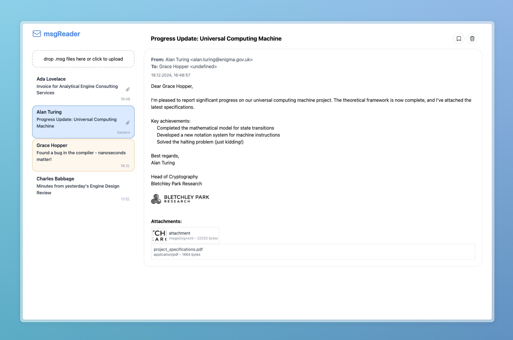

# msgReader

Open Outlook `.msg` and `.eml` email files in your browser or on your desktop. Read message bodies, view inline images, and work with attachments without connecting an email account.

**[Open the web app](https://rasalas.github.io/msg-reader/)** · **[Download the desktop app](https://github.com/Rasalas/msg-reader/releases/latest)**



## Try it in your browser

1. Open [msgReader](https://rasalas.github.io/msg-reader/).
2. Drop one or more `.msg` or `.eml` files into the window, or use the file picker.
3. Select a message to read it and open or save its attachments.

## What it does

- Read HTML and plain-text emails, including embedded images.
- Open multiple messages, search their contents, and sort them by date.
- Pin messages and navigate with keyboard shortcuts.
- Preview supported attachments and save them as files.
- Use light, dark, or system appearance.

Message files are parsed locally in your browser or desktop app, without uploading them to a parsing service. HTML emails can still reference remote images that make network requests. The desktop app also checks for updates online.

## Desktop downloads

Installers for Windows, macOS, and Linux are available on the [latest release page](https://github.com/Rasalas/msg-reader/releases/latest).

| Platform             | Installer                         |
| -------------------- | --------------------------------- |
| macOS, Apple Silicon | `.dmg` with `aarch64` in the name |
| macOS, Intel         | `.dmg` with `x64` in the name     |
| Windows              | `.msi` or `-setup.exe`            |
| Linux                | `.AppImage`, `.deb`, or `.rpm`    |

The desktop app supports opening `.msg` and `.eml` files from your file manager and checks for updates automatically. Features on the main branch can be newer than the latest desktop release.

### If the operating system blocks installation

Unsigned desktop builds can trigger macOS Gatekeeper or Windows SmartScreen. On macOS, follow [Apple's guidance for opening apps](https://support.apple.com/en-us/102445). On Windows, review the source of the downloaded installer before deciding whether to proceed. The [web app](https://rasalas.github.io/msg-reader/) is also available without installing anything.

## Why I built it

A colleague regularly sent me emails saved as `.msg` files. I wanted to read them, including their HTML and inline images, but my Outlook setup would not open them despite an active subscription. I built a small browser tool for that workflow and later added a desktop version.

msgReader builds on existing libraries, including [msgreader](https://github.com/HiraokaHyperTools/msgreader) for Outlook files and [DOMPurify](https://github.com/cure53/DOMPurify) for sanitizing HTML. The desktop app uses [Tauri](https://tauri.app/).

## Report a problem or contribute

Use [GitHub Issues](https://github.com/Rasalas/msg-reader/issues) for bug reports and feature requests. For a parsing or display problem, include your browser or desktop-app version, the file format, and what you expected to see. A small sample message with personal information removed helps reproduce the problem.

## Local development

The web app uses JavaScript, Vite, and Tailwind CSS. Use Node.js 20.19+ or 22.12+ with npm.

```bash
git clone https://github.com/Rasalas/msg-reader.git
cd msg-reader
npm ci
npm run dev
```

The development server runs at [localhost:8080/msg-reader/](http://localhost:8080/msg-reader/).

| Command               | Purpose                                           |
| --------------------- | ------------------------------------------------- |
| `npm run dev`         | Start the Vite development server                 |
| `npm run build`       | Build the web app into `dist/`                    |
| `npm run preview`     | Preview the production build locally              |
| `npm test`            | Run the Jest tests                                |
| `npm run lint`        | Check JavaScript with ESLint                      |
| `npm run format`      | Format JavaScript with Prettier                   |
| `npm run tauri:dev`   | Run the desktop app in development mode           |
| `npm run tauri:build` | Build desktop installers for the current platform |

Desktop development also requires Rust and the [Tauri prerequisites for your platform](https://v2.tauri.app/start/prerequisites/).

### Source layout

- `src/js/`: message state, file parsing, search, export, and shared utilities.
- `src/js/ui/`: message list, content rendering, and attachment previews.
- `src-tauri/`: desktop integration, file handling, and updates.
- `tests/`: unit and integration tests.

## License

[MIT](LICENSE).
